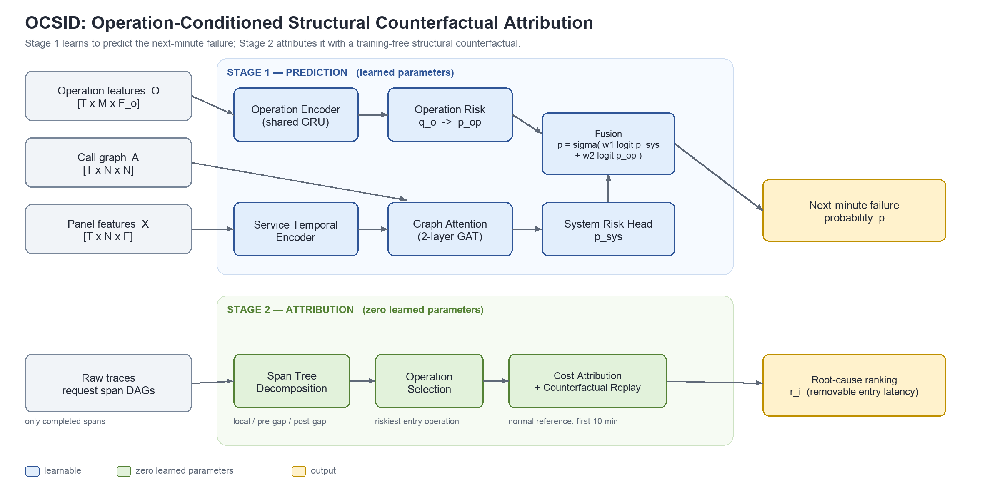

# 论文叙事结构：从背景到我们的方法

> 配套文件：模型结构图 `docs/figures/ocsid_architecture.png`；
> 方法章节 `docs/2026-11-24-method-section-academic.md`；
> 结果汇总 `docs/2026-11-24-master-results-summary.md`。

**图 1：OCSID 框架。** 阶段一（蓝色）用服务时序、调用图与入口 operation 预测下一分钟故障；
阶段二（绿色）用零训练的结构反事实，把服务恢复正常并重放请求，按可移除入口时延排序根因。

---

## 1. 一句话主线

> 运维要回答的不是“谁最异常”，而是“修谁有用”。
> 现有方法都在给异常打分；而请求的 span 树本身给出了精确的结构方程，
> 让“修谁有用”可以直接算出来。于是我们把预测（学习）和归因（结构）解耦。

这句话是整篇论文的骨架：背景引出“修谁有用”，related work 说明现有方法都在给异常打分，
然后我们指出请求树提供了直接计算的条件，最后给出两阶段方法。

---

## 2. 背景怎么写

背景段要建立三件事：

1. **问题重要**：微服务调用链深、故障传播快，下一分钟是否故障、根因是谁，
   直接决定是否告警、先修哪里；
2. **数据现成**：metric、log、trace 三类遥测都在，但现有方法主要用分钟级聚合；
3. **任务定义**：给定过去 5 分钟，预测下一分钟是否出现用户可感知故障，并排序根因服务；
   标签来自入口业务退化，根因是注入服务。

背景段不要一上来讲方法，先把“为什么这个问题值得做”讲清楚。
可以强调：预测回答“要不要叫人”，定位回答“叫谁”，后者直接决定修复时间。

---

## 3. Related Work 怎么分组

Related work 建议分三组，每组都落到“它解决了什么、它没解决什么”。

### 3.1 多模态/图预测

代表：LTFP、InstantOps、Eadro、MTG 等。

- 它们把 metric/log/trace 编码成服务表示，用图传播捕捉跨服务影响；
- 在预测指标上很强：LTFP AP 0.885/0.843（OB/TT），InstantOps F1 0.825（OB）；
- **但定位弱**：InstantOps 在 OB 的 Hit@1 只有 0.281，GCN-GRU 只有 0.390。
  原因是这些模型的优化目标是“系统是否故障”，不是“哪个服务导致”。

**这一段的作用**：说明“预测强 ≠ 定位强”，为后面的 gap 埋下伏笔。

### 3.2 异常定位类 RCA

代表：TraceRCA、MicroRank、TVDiag、TORAI、DiagFusion、RCD。

- 它们在请求/调用图上计算异常分数、传播重要度或聚类；
- 在部分数据集上有效：CIRCA 在 OB 的 Hit@1 0.727，TVDiag 在 TT 的 0.781；
- **共同问题**：给“异常大小”排序。症状服务的 span 也很大（因为它包含了根因的时间），
  异常分数同样高；而且它们在 OB/TT 上不稳定（CIRCA OB 0.727 → TT 0.562；
  TVDiag OB 0.455 → TT 0.781）。

**这一段的作用**：说明“异常大 ≠ 可移除影响大”，并给出跨数据集不稳定的证据。

### 3.3 因果/结构类方法

代表：CIRCA 以及基于因果图/结构因果模型的 RCA。

- 它们做反事实：假设某个服务正常，系统异常会不会消失；
- 方向是对的，但**因果图通常是学出来或先验的**，图错了归因就错；
- 在 TT 这种 27 个服务、17 个入口 operation 的系统上，服务级因果图很难对准，
  CIRCA 掉到 0.562/0.671。

**这一段的作用**：说明“反事实方向对，但结构来源不可靠”，为 CPCA 用观测 DAG 做铺垫。

### 3.4 Gap 段

把上面三条收束成一句话：

> 现有方法要么给异常大小排序，要么在服务级学一个因果图；
> 但根因标签是“注入服务”，它问的是“把谁恢复正常，入口退化会消失”。
> 在分钟级粒度下，根因和症状同时变化，异常大小无法区分二者；
> 服务级指标也无法区分“自己慢”和“继承慢”。

这段之后，读者会期待一个“能直接估计干预效果”的方法——这就是我们的切入点。

---

## 4. 现有方法与我们的方法对比

| 类别 | 代表方法 | 打分对象 | 粒度 | 需要的监督 | 在本文数据上的问题 |
|---|---|---|---|---|---|
| 多模态/图预测 | LTFP、InstantOps、Eadro | 系统故障概率 | 服务–分钟 | 窗口标签 | 预测强、定位弱（InstantOps OB H@1 0.281） |
| 异常定位 RCA | TraceRCA、MicroRank、TVDiag、TORAI | 异常大小/传播重要度 | 请求/图 | 无或弱 | 症状也高分；OB/TT 不稳定 |
| 因果图 RCA | CIRCA | 干预后异常概率 | 服务–指标 | 学习/先验因果图 | 图不准；TT 崩到 0.562/0.671 |
| 学习式排序 | 本文早期学习头（已删除） | 学习式根因分 | 服务 | 事件标签（55/64） | 小样本过拟合，弱于 CPCA |
| **本文** | **OCSID + CPCA** | **可移除入口时延** | **请求–operation** | **零训练** | 需要 trace 覆盖（约 90%） |

这张表建议放在 Related Work 末尾或 Introduction 里，让读者一眼看到差异。

---

## 5. 三个关键观察（引出方法）

### 观察 1：请求的 span 树给出精确的结构方程

对每个 span：

$$
d_s=\mathrm{self}_s+\Big|\bigcup_{c\in C(s)}[\mathrm{start}_c,\mathrm{end}_c]\Big|.
$$

这不是假设，是时间轴上的守恒关系。于是“恢复某个服务会怎样”可以直接重放算出来，
不需要学一个因果图。

### 观察 2：delay 的等待落在调用方的 post-gap 里

实测：delay 注入时 `post-gap` 从 0.7 ms 涨到 200.8 ms，`pre-gap` 基本不变；
CPU/disk 只抬高服务自身 `local`。

这意味着：如果把返回路径等待留给调用方（exclusive 的常见做法），
delay 类故障会被算到调用方头上。必须把边等待归给**被调用方**。

### 观察 3：根因标签就是干预目标

标签是“注入服务”，它定义的是“把谁恢复正常，入口退化会消失”。
所以最自然的估计量不是异常分数，而是：

$$
r_i=\frac{\sum_\tau \big(D(\tau)-\tilde D_i(\tau)\big)}{\sum_\tau D(\tau)}.
$$

这三个观察直接对应 CPCA 的三条设计：结构重放、边等待归被调用方、可移除时延。

---

## 6. 我们的方法怎么讲

方法部分按“两阶段 + 三个设计点”讲：

1. **阶段一（预测）**：服务时序 + 图 + operation 风险 → $p$。
   这一段不需要讲得太花，重点是“预测是载体，不是贡献”；
2. **阶段二（归因）**：CPCA。
   - 设计点 1：span 分解（local / pre / post）；
   - 设计点 2：边等待归被调用方；
   - 设计点 3：反事实重放 + 责任分 $r_i$；
3. **Operation 条件化**：TT 标签是 per-operation，选最风险 operation 再算 $r_i$；
4. **两阶段解耦的理由**：预测需要图，归因需要请求级结构；端到端会负迁移。

讲的时候要不断回到“修谁有用”这条主线：
每个设计点都在回答“为什么这样算出来的 $r_i$ 更接近‘修谁有用’”。

---

## 7. 贡献怎么写

建议三条，按“问题—方法—实证”排序：

1. **问题层**：指出分钟级 RCA 的失败模式是“异常大小 ≠ 可移除影响”，
   给出与注入标签语义对齐的反事实估计量；
2. **方法层**：提出 CPCA，用观测到的请求 span DAG 的结构方程做精确重放，
   不需要学习因果图；并给出“边等待归被调用方”的归因规则；
3. **实证层**：在 4 个框架 + 10 个 specialist + 3 个种子上验证，
   CPCA 在 OB/TT 的事件级和窗口级都领先，且是唯一跨两个数据集都稳定的方法；
   并报告早期学习式根因头被删除的负结果（与 CPCA 冗余）。

---

## 8. Introduction 草稿（中文，可直接翻译）

### 第 1 段：背景与问题

微服务系统中，一次用户请求往往跨越数十个服务。单个服务的资源争用、网络抖动或依赖故障，
会沿着调用链迅速传播，最终表现为入口业务的延迟退化。运维团队面临两个连续的问题：
下一分钟系统是否会出现用户可感知的故障，以及如果出现，应该先修哪个服务。
前者决定是否告警，后者决定修复顺序；在故障传播迅速的系统中，后者的价值往往更大。

### 第 2 段：现有方法与 gap

现有研究大致分为两类。一类是多模态或图神经网络预测模型，它们把 metric、log、trace
编码成服务表示，在预测指标上表现很强，但其优化目标是系统是否故障，根因定位通常较弱。
另一类是基于异常分数的 RCA 方法，它们在请求或调用图上计算异常大小、传播重要度或聚类。
这些方法的共同点是给“异常”排序；然而根因标签是注入服务，它问的是
“把谁恢复正常，入口退化会消失”。在分钟级粒度下，根因和症状往往同时变化，
症状服务的 span 也包含了根因的时间，因此异常大小无法区分二者。

### 第 3 段：关键观察与我们的思路

我们注意到，请求的 span 树本身提供了精确的结构方程：
每个 span 的时长等于其自身时间加上子调用区间的并集。
这意味着“把某个服务恢复正常，入口时延会变成多少”可以直接重放计算，
而不需要学习一个服务级因果图。进一步地，网络延迟的等待主要出现在调用方的后置空档中，
应当归给被调用方，而不是调用方。基于这两个观察，我们把根因定位重新定义为一个
结构反事实估计问题：恢复服务 $i$，重放请求，入口时延的下降比例即为 $i$ 的责任分。

### 第 4 段：方法与结果

我们提出 OCSID：阶段一用服务时序、调用图与入口 operation 风险预测下一分钟故障；
阶段二用零训练的结构反事实归因（CPCA）排序根因。在 RE2-OB 与 RE2-TT 上，
OCSID 的预测 AP 达到 0.966/0.866，高于 LTFP 的 0.919/0.846；
CPCA 的事件级 Hit@1/MRR 达到 0.855/0.920 与 0.953/0.971，
高于 LTFP 的 0.782/0.874 与 0.875/0.923，也高于 CIRCA、TVDiag 等 10 个 specialist。
消融进一步表明，预测侧的图与 operation 头是必要的；早期学习式根因头与 CPCA 冗余，已删除。

---

## 9. Related Work 草稿（中文）

### 9.1 多模态与图预测

LTFP 将 metric、log、trace 分别编码后做门控融合，并用图注意力传播服务表示；
InstantOps 用 GCN + GRU 做系统级预测；Eadro 用多源编码与图传播联合检测和定位。
这些模型在预测指标上很强，但其训练目标是系统级故障标签，根因定位是副产物。
在我们的实验中，InstantOps 在 OB 的 F1 达到 0.825，但 Hit@1 只有 0.281；
GCN-GRU 的 AP 为 0.918，Hit@1 只有 0.390。这说明预测能力不能自动转化为定位能力。

### 9.2 异常定位类 RCA

TraceRCA 在请求级检测异常 span 并聚类；MicroRank 在服务图上做带权 PageRank；
TVDiag、TORAI、DiagFusion、RCD 等方法从不同角度构造异常分数或图传播。
它们在某些数据集上有效，但共同点是给“异常大小”排序：
症状服务的 span 包含了根因的时间，异常分数同样高。
实验上，CIRCA 在 OB 的 Hit@1 为 0.727，在 TT 掉到 0.562；
TVDiag 则相反（0.455 → 0.781），说明这类方法对数据集结构敏感。

### 9.3 因果与结构方法

CIRCA 用因果图与反事实干预做 RCA，方向与本文一致。
但它依赖学习或先验的服务级因果图；在服务多、入口 operation 多的系统中，
图很难对准，归因随之失效。本文不学习因果图，而是利用请求 span 树的结构方程，
在请求级直接计算干预效果。这是与 CIRCA 最本质的区别。

---

## 10. 过渡句（写作时可直接用）

- 从背景到 gap：
  > 然而，预测能力强并不等于定位能力强；现有 RCA 方法在跨系统场景下表现出明显的不稳定性。
- 从 gap 到观察：
  > 这促使我们重新审视请求本身：span 树是否已经包含了足够的结构信息，使干预效果可以直接计算？
- 从观察到方法：
  > 基于这一观察，我们把根因定位重新定义为一个结构反事实估计问题，并提出 CPCA。
- 从方法到实验：
  > 我们在两个公开数据集、4 个框架与 10 个 specialist 上验证该估计量是否比异常排序更稳定。

---

## 11. 图表清单

| 编号 | 内容 | 状态 |
|---|---|---|
| 图 1 | OCSID 框架（本文件） | 已生成 `docs/figures/ocsid_architecture.png` |
| 图 2 | span 分解例子（frontend→checkout→payment，local/pre/post） | 建议补，可用表或树图 |
| 表 1 | 4 框架 + 10 specialist 的预测/定位主表 | 已有 `docs/2026-11-24-master-results-summary.md` |
| 表 2 | OCSID 三种子 + 校准 | 已有 |
| 表 3 | 消融（no-graph / no-operation） | 已有 |
| 表 4 | 融合负结果（λ 曲线、RRF） | 已有 |

**图 2 的建议**：画一棵三节点的 span 树，标注 `d/self/local/pre/post` 与
“恢复 payment 后入口时延 1000→260”。这张图能让审稿人一眼看懂 CPCA，
比公式更有效。
